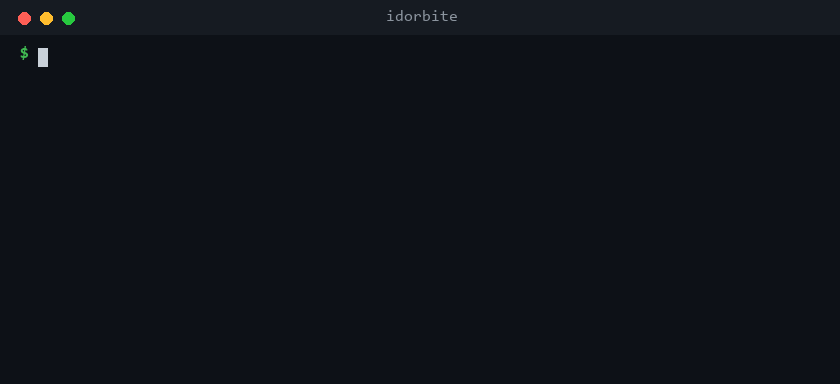

# idorbite 🦈

**Find broken object-level authorization (IDOR / BOLA) in JS/TS backends — the #1 API security risk — by spotting handlers that forgot the check their siblings have.**

<p align="center">
  
</p>

The most common access-control bug in real apps isn't exotic. It's one route handler that
queries a resource *without* the ownership/tenant scope that every sibling handler on that same
resource applies. `idorbite` finds those gaps with a real AST — no API key, fully offline.

```bash
npx idorbite ./src
```

```
[HIGH] app/api/teams/[teamId]/datarooms/[id]/documents/route.ts:5  GET GET
  GET GET has no authorization check, but 2 sibling(s) on "dataroomdocument" do
  (POST, GET). Review for broken object-level authorization.
  guarded siblings: POST (teamId); GET (teamId)
```

## Why it works

Across real-world breaches (and a drawer full of published advisories), the same shape recurs:

```ts
// ✅ every other handler scopes to the caller's tenant
export const POST = withTeamApi(async (req, { params }) =>
  prisma.dataroomDocument.create({ where: { id: params.id, teamId: req.teamId } }));

// ❌ this one forgot — any team can read any dataroom's documents
export const GET = withTeamApi(async (req, { params }) =>
  prisma.dataroomDocument.findMany({ where: { dataroomId: params.id } }));
```

Authentication wrappers (`withTeamApi`, `@UseGuards`, `getServerSession`) don't save you here —
the handler is authenticated, it just never checks the object belongs to you. `idorbite` keys on the
**object-scope** signal (a `where { teamId }`, a `verifyOwnership()` call), not on authentication, so
it catches exactly this class.

## What it supports

- **NestJS** controllers (`@Controller`, `@Get/@Post/...`, `@Param`, `@HasPermission`, `@Impersonation`, …)
- **Next.js App Router** route handlers (`route.ts` exporting `GET`/`POST`/…, incl. wrapped `withX(handler)`)
- Pages Router & Express: on the roadmap.

## Usage

```bash
npx idorbite [path]                 # scan a directory (default: .)
npx idorbite ./src --json           # machine-readable output
npx idorbite ./src --min-confidence medium
npx idorbite ./src --fail-on high   # non-zero exit for CI (default: high)
```

Confidence tiers: **high** (≥2 siblings guard, the handler takes an object id, this one doesn't),
**medium** (weaker signals), **low** (review only).

## Honest limitations

`idorbite` is a **ranker, not a prover**. It does not do taint analysis — it flags handlers worth a
human look and tells you *which sibling guards and how*. It will miss gaps where the scope is applied
in a way it can't see, and it will occasionally flag a handler that's fine for a reason it can't know
(a genuinely global/public read). It never claims a vulnerability. Treat findings as leads, highest
confidence first. Suppress a reviewed false positive with `// idorbite-ignore`.

## License

MIT
